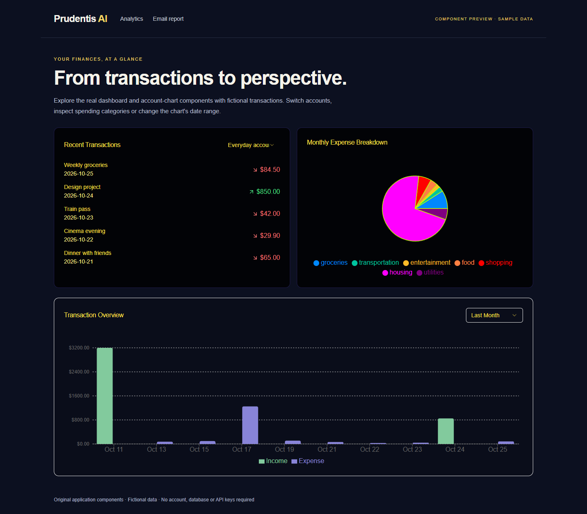
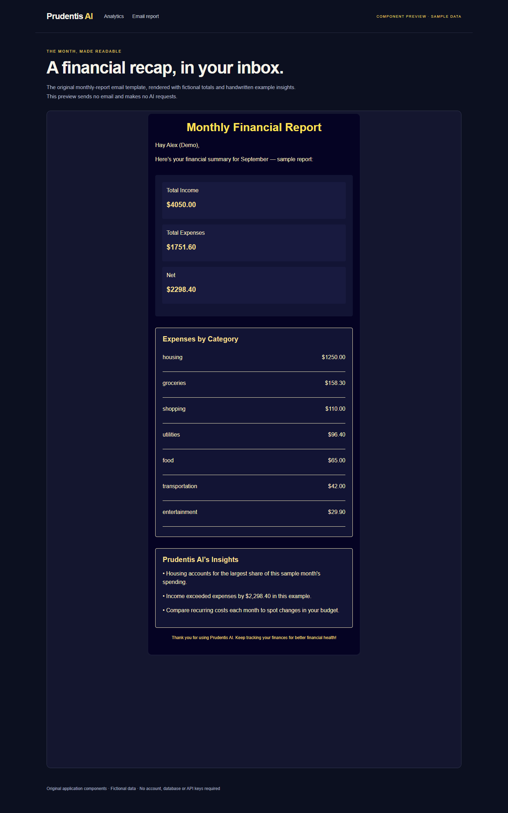
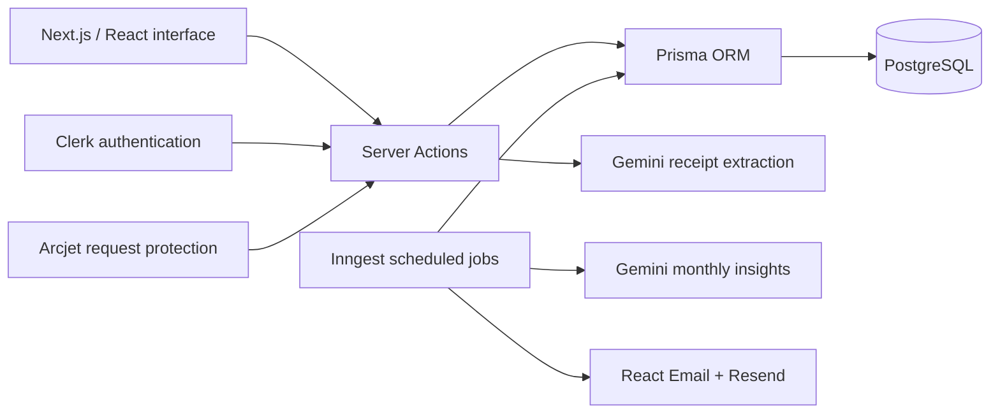

# Prudentis AI

### Know where your money goes. Make room for what matters.

A full-stack personal finance demo that brings accounts, transactions and spending patterns into one place — with AI receipt extraction and scheduled financial reports built into the codebase.

[](https://nextjs.org/)
[](https://react.dev/)
[](prisma/schema.prisma)
[](#project-status)

[Request a demo](docs/DEMO.md#request-a-demo) · [Set up the full app](docs/SETUP.md) · [Verification](docs/VERIFICATION.md) · [Architecture](docs/ARCHITECTURE.md) · [Deutsch](README.de.md)



*Real application components in the isolated component preview. The surrounding preview page and fictional data are provided for demonstration; this is not a screenshot of an authenticated user account.*

## Why Prudentis AI?

Money management works better when the details connect. Prudentis AI links individual transactions to account balances, category breakdowns and a monthly budget, so the interface can answer practical questions: What did I spend? Which categories dominate? How much of my budget is left?

The project also explores where automation helps: extracting receipt fields, processing recurring transactions and delivering monthly summaries. It is a working codebase for learning, demonstrations and further development, with integration requirements and known limitations documented below.

## What is inside

| Capability | Implementation |
| --- | --- |
| **Multiple accounts** | Current and savings accounts, opening balances, a default account, search and bulk account actions. |
| **Transaction management** | Income and expenses, categories, dates, editing, filtering and bulk deletion. |
| **Visual analytics** | Recent transactions, monthly spending by category and income-versus-expense charts with selectable date ranges. |
| **Monthly budget** | A budget per user, tracked against spending in the default account. |
| **Receipt extraction** | Gemini integration suggests amount, date, description, merchant and category from an uploaded image. Authenticated, rate-limited scan attempts; requires a configured API key. |
| **Recurring transactions** | Daily, weekly, monthly and yearly intervals, processed through Inngest jobs. |
| **Email summaries** | Monthly reports and budget alerts at 80% usage, using React Email and Resend. |
| **Authentication and request protection** | Clerk authentication, Arcjet middleware and a transaction-creation rate limit. |
| **Exchange-rate endpoint** | Open Exchange Rates data with an EUR-based view; transaction amounts currently display in USD. |

**Scope:** accounts are managed inside the application. Bank synchronization, card linking, payment processing and per-account currency accounting are not implemented.

## See it in action

**Hosted demo access is activated on request.** Contact the maintainer through the [demo request instructions](docs/DEMO.md#request-a-demo). This repository does not advertise an always-on public deployment.

### Preview without accounts or API keys

Use Node.js 22 and npm, then run:

```sh
git clone https://github.com/CodeCoderCodingCode/PrudentisAI-Demo.git
cd PrudentisAI-Demo
npm ci --legacy-peer-deps
npm run preview
```

Open **[127.0.0.1:3001](http://127.0.0.1:3001)** for the real dashboard and account-chart components. Switch accounts, hover over chart segments and change the date range. Open **[/reports](http://127.0.0.1:3001/reports)** for the original monthly-report email template.

The preview is a separate local Next.js app in [`preview/`](preview/). It uses fictional transactions and handwritten example report insights, performs no database writes and sends no emails or AI requests. It does not exercise login, receipt scanning or background jobs. No changes to the main application's authentication are needed.

The installation flag accommodates the existing React 19 / React Day Picker 8 peer dependency conflict. It does not upgrade the locked dependencies.

<details>
<summary><strong>Preview the actual monthly-report email</strong></summary>



The numbers and insights are demonstration fixtures. This is a browser capture of [`emails/template.jsx`](emails/template.jsx), not a generated illustration or a live Gemini response.

</details>

Want a guided walkthrough or your own screenshots? Follow the **[demo and screenshot guide](docs/DEMO.md)**.

### Run the complete application

The complete app needs PostgreSQL, a Clerk development instance and an Arcjet key. Gemini, Resend, Inngest and Open Exchange Rates enable their respective integrations.

1. Install dependencies using the commands above.
2. Copy [`.env.example`](.env.example) to `.env` and fill in your development credentials.
3. Apply the checked-in database migration:

   ```sh
   npx prisma migrate deploy
   ```

4. Run `npm run dev` and open [localhost:3000](http://localhost:3000).
5. Sign up, create your first account and add a transaction.

See **[the setup guide](docs/SETUP.md)** for environment variables, background jobs, provider configuration and troubleshooting.

## How it fits together



The isolated preview imports the existing visual components directly, supplying sample props in place of Server Action and database results. See [architecture and data flow](docs/ARCHITECTURE.md) for the application routes, schema and schedules.

## Tech stack

| Layer | Tools |
| --- | --- |
| Application | Next.js 15 App Router, React 19, JavaScript |
| UI | Tailwind CSS, Radix UI / shadcn-style components, Lucide, Recharts |
| Forms | React Hook Form, Zod |
| Data | PostgreSQL, Prisma 6 |
| Identity and protection | Clerk, Arcjet |
| AI | Google Generative AI SDK |
| Background work and email | Inngest, React Email, Resend |

Versions are defined by [`package.json`](package.json) and [`package-lock.json`](package-lock.json); badges describe the codebase, not a claim that dependencies are current.

## Repository map

```text
app/                 Landing, auth, dashboard, account and transaction routes
actions/             Account, budget and transaction Server Actions
components/          Shared UI, navigation and account creation
data/                Transaction categories and landing-page content
prisma/              Database schema and checked-in migration
lib/inngest/         Scheduled jobs and event processing
emails/              Monthly-report and budget-alert templates
preview/             Independent local preview using real UI components
docs/                Setup, demo guide, architecture and actual screenshots
```

## Development

| Command | Purpose |
| --- | --- |
| `npm run dev` | Full application on port 3000; requires service configuration. |
| `npm run preview` | Local component preview on port 3001; requires no credentials. |
| `npm run preview:build` | Build the isolated preview without external service credentials. |
| `npm run lint` | Run ESLint using the checked-in flat configuration. |
| `npm test` | Check AI model configuration and receipt upload validation without provider calls. |
| `npm run build` | Build the full application; service configuration is required when serving requests. |
| `npm start` | Serve a completed production build of the full application. |
| `npm run email` | React Email development server; the base template needs sample props. |

The [quality workflow](.github/workflows/quality.yml) checks lint, unit tests, the preview build and the full application build without application secrets. Authenticated pages render per request. Integration behavior requires configured services and is not established by these builds.

## Project status

This repository is a **demo**, with implemented product flows and some unfinished integration details:

- **AI configuration:** the retired Gemini 1.5 model has been replaced by a shared [`GEMINI_MODEL` configuration](lib/gemini.mjs), defaulting to `gemini-3.5-flash-lite`. Google currently lists a [Free tier](https://ai.google.dev/gemini-api/docs/pricing) for this model. The demo project's Free tier was confirmed in AI Studio, and a live fictional receipt-text test returned the expected JSON. Your own project's access and quotas still require verification. See [free AI setup](docs/AI.md).
- **Seed endpoint:** the legacy `/api/seed` route is disabled and returns HTTP 410. It does not execute the old generator with fixed user/account IDs. Add fictional transactions through the account interface instead.
- **Landing-page content:** usage numbers, ratings and testimonials are demonstration copy, not verified customer or operational metrics. Existing illustrations are not application screenshots.
- **Deployment readiness:** Next.js and its ESLint configuration are updated to 15.5.28, the currently documented patched 15.x release. Protected-route matching and the sign-in redirect have been corrected. Receipt scans require authentication, reject unsupported or oversized files server-side and use a dedicated Arcjet limit. Provider configuration, recurring-job behavior and end-to-end use still need verification before real financial data is used.
- **Verification:** the local visual preview can be checked without credentials; end-to-end authentication, database, AI and email delivery require a separate configured integration run.

See the [architecture notes](docs/ARCHITECTURE.md#implementation-notes) for specific follow-up areas.

## Contributing and usage

Improvements are welcome — see [CONTRIBUTING.md](CONTRIBUTING.md) for a focused workflow and verification steps. Report reproducible problems through [GitHub Issues](https://github.com/CodeCoderCodingCode/PrudentisAI-Demo/issues).

No license file is currently included. Public visibility alone does not grant a general license to redistribute or reuse the code; ask the repository owner about intended licensing.
