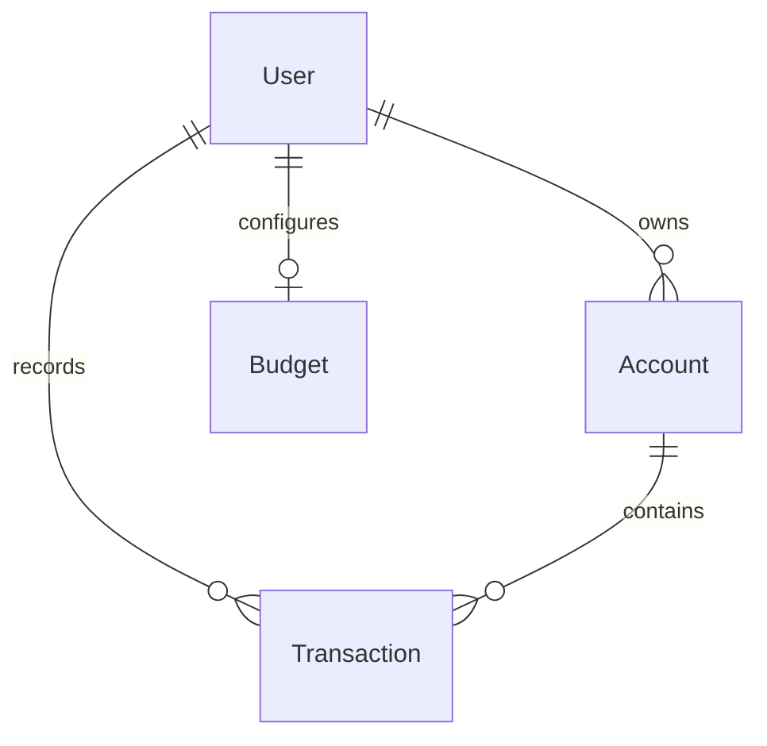

# Architecture and implementation notes

[← README](../README.md) · [Setup](SETUP.md)

## Application boundaries

The main app uses the Next.js App Router. React client components handle forms, tables and charts; Server Actions handle authenticated operations and Prisma persistence. There is no separate Express backend.

| Route / area | Responsibility |
| --- | --- |
| `/` | Marketing landing page. |
| `/sign-in`, `/sign-up` | Clerk UI in the auth route group. |
| `/dashboard` | Default-account budget, recent transactions, spending categories and account management. |
| `/account/[id]` | Individual account chart and transaction table. |
| `/transaction/create` | Transaction creation and editing, including optional receipt scanning. |
| `/api/inngest` | Inngest function registration and execution endpoint. |
| `/api/exchangeRates` | Open Exchange Rates proxy with an EUR-based view. |
| `/api/seed` | Retired endpoint; returns HTTP 410 without executing the legacy generator. |

`preview/` is a separate Next.js app with its own layout and configuration. It imports existing presentation components without importing the main app's Clerk layout, middleware or database actions. It is started explicitly with `npm run preview` and is not deployed by the quality workflow.

## Data model

- `User` connects the local database record to Clerk through `clerkUserId`.
- `Account` stores current/savings type, a Decimal balance and a default-account flag.
- `Transaction` stores income/expense, Decimal amount, category, date and optional recurrence metadata.
- `Budget` is unique per user. The UI measures monthly spending against the default account.

The schema uses the historical spellings `isReccurring` and `reccurringInterval`. These are persistent field names; renaming them requires coordinated application and migration changes.

## Transaction and AI flow

Creating a transaction checks Clerk identity, applies the Arcjet transaction bucket, verifies account ownership, inserts the record and updates the balance within a Prisma transaction. Actions then invalidate the dashboard and relevant account path.

Receipt scanning separately checks authentication, validates file metadata and applies the dedicated scan bucket before calling Gemini. It returns suggested fields for the form; it does not save a transaction automatically. Both receipt scanning and report insight generation use `lib/gemini.mjs`, so model selection is configured once through `GEMINI_MODEL`.

AI requests and uploaded images leave the application for Google's API. See [AI setup](AI.md) for quota and data-handling considerations.

## Background jobs

| Function | Trigger | Work |
| --- | --- | --- |
| `checkBudgetAlert` | `0 */6 * * *` | Check default-account monthly expenses; send an alert at 80% usage, at most once per month according to `lastAlertSent`. |
| `triggerRecurringTransactions` | `0 0 * * *` | Find recurring transactions and emit processing events. |
| `processRecurringTransaction` | `transaction.recurring.process` | Create a due transaction and update account balance and recurrence timestamps. |
| `generateMonthlyReports` | `0 0 1 * *` | Aggregate the previous month, request insights and send email summaries. |

The cron expressions are interpreted by Inngest, not by the user's browser timezone. Jobs require a registered, reachable Inngest endpoint. The preview does not register them. Their presence in source does not establish successful delivery in a deployment.

## Implementation notes

These areas remain follow-up work rather than capabilities established by the documentation and preview:

1. **Full route protection.** Middleware now matches the bare dashboard and the actual `/transaction` prefix and uses Clerk's `auth.protect()` redirect. Verify these flows with the deployment's Clerk instance. Server Actions also enforce identity.
2. **Legacy seeding.** `/api/seed` is disabled and returns HTTP 410. The historical generator is not imported by that endpoint and must not be reconnected to a public route.
3. **Recurrence semantics.** The current due-check treats a missing `lastProcessed` as immediately due. Verify first-run dates, month-end behavior, retries and duplicate-event idempotency with a test database.
4. **Date boundaries.** Some monthly queries use the final day at midnight as an inclusive end. Review end-of-day coverage, timezone handling and first-of-month reports across short months.
5. **Concurrent balances.** The creation action reads a balance before writing a calculated new value. Review concurrent writes and default-account changes with realistic integration tests.
6. **AI contract.** The provider model is configurable and bounded, but extraction accuracy, response shape and SDK compatibility still need a live test. MIME/size checks do not inspect the actual binary image signature. Review model output validation before relying on extracted financial values.
7. **Email errors.** Confirm both API return values and job outcomes. Resend may return an error payload rather than throwing; retry and `lastAlertSent` behavior need a configured delivery test.
8. **Dependency maintenance.** Next.js and eslint-config-next are updated to 15.5.28 following the October 2026 security advisory. Other dependencies still need routine maintenance; this targeted update is not an application-wide vulnerability assessment.

The full application's root layout is dynamic, so authenticated pages are rendered per request instead of during a build. Both the preview and the full application now build without service credentials; runtime functionality still needs configured services. Database migrations enable row-level security and revoke access from Supabase's public REST roles, as the application accesses these tables through Prisma on the server.

The UI's exchange-rate endpoint is separate from stored monetary values. Transactions currently display `$` and the schema has no currency field. Marketing text about customer metrics, testimonials or broad multi-currency support should not be treated as verified product behavior.
